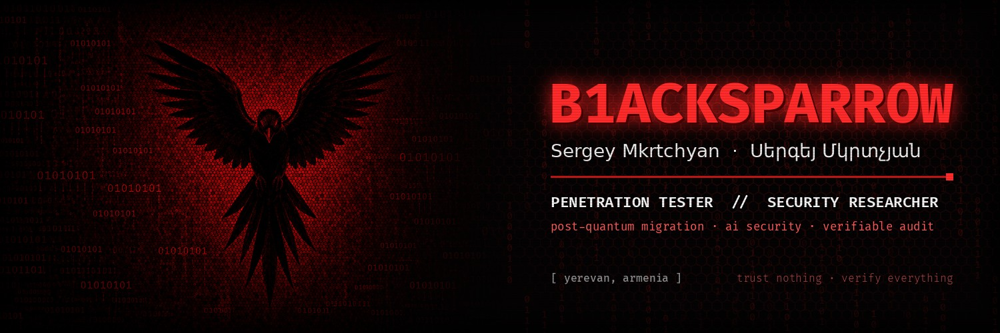

  

  
  
  

### `$ whoami`

### `$ ls ~/research`

### `$ ls /opt/arsenal`

  
  
  
  
  
  
  
  
  
  
  

  
  
  
  
  
  
  
  
  
  
  
  

<code>// trust nothing · verify everything</code>

